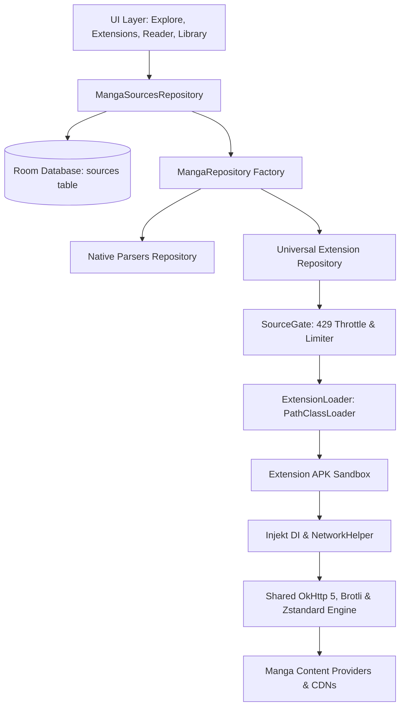

<div align="center">


# ZERAVRIX Phone 2.0

### Next-Generation Manga and Manhwa Reader for Android

[](https://zeravrix.pages.dev/)
[](https://github.com/zeravrix/ZERAVRIX-Phone)
[](https://github.com/zeravrix/ZERAVRIX-Phone)
[](LICENSE)
[](https://github.com/zeravrix/ZERAVRIX-Phone/releases)

<br/>

ZERAVRIX Phone 2.0 combines the speed and battery efficiency of native source parsers with the boundless ecosystem of universal manhwa, manga, manhua, and comics source extensions, wrapped in a Material Design 3 interface.

[Official Website](https://zeravrix.pages.dev/) • [Download Latest APK](https://github.com/zeravrix/ZERAVRIX-Phone/releases) • [Specifications](#specifications) • [Architecture](#architecture) • [Building](#building-from-source)

</div>

---

## Specifications

| Specification | Value |
|---|---|
| Application ID | org.zeravrix.android |
| Minimum Android | Android 8.0 (API 26) |
| Target Android | Android 14 (API 34) |
| Supported Extensions | Universal Manhwa, Manga, Manhua, and Comics APKs (Lib 1.4 and 1.6) |
| Primary Database | SQLite via Android Jetpack Room |
| Networking Engine | OkHttp 5 + Conscrypt + Brotli and Zstandard (zstd) Compression |
| Image Pipeline | Coil 3 + Subsampling Scale ImageView |
| In-App Updates | Anonymous GitHub Releases API Integration |

---

## Key Capabilities

### Universal Manhwa / Manga / Manhua / Comics Source Extension Runtime
- Universal Extension Compatibility: Browse, install, trust, and run thousands of community source APKs directly.
- Single Source of Truth: All native and extension sources integrate into the Room database, guaranteeing instant search, pinning, reordering, and usage tracking.
- Contextual Source Management: Explore sources directly, pin to Explore tab, or uninstall seamlessly.
- Direct Repository Management: Connect HTTPS extension repositories with automated index updates.

### Immersive Reader Engine
- Adaptive Reading Modes: Continuous Webtoon vertical scroll with zero gap, Left-to-Right, Right-to-Left, and Dual-Page landscape viewing.
- Resilient Downloads: Multi-threaded background chapter downloads with pause, resume, and storage volume selection.
- Brotli and Zstandard Compression Pipeline: Full unstripped Brotli, Zstandard (zstd), and OkHttp network pipeline for high-speed image delivery and CDN compatibility.
- Smart Image Processing: Dynamic split-image rendering, border cropping, and night reading color adjustments.

### Privacy and Security
- Cryptographic Signature Verification: Verifies APK signatures against trusted repository certificates before loading.
- Untracked Local Signing: Build credentials and keystores remain strictly externalized and uncommitted.
- Anonymous In-App Updates: Background release discovery runs anonymously via public endpoints without personal access tokens or telemetry.
- Zero Trackers: Fully client-side execution with local database persistence and encrypted backup and restore.

---

## Architecture



---

## Tech Stack

| Layer | Technologies |
|---|---|
| Architecture | Model-View-ViewModel (MVVM) + Clean Architecture + Hilt DI |
| Language | Kotlin 2.0 with Coroutines and StateFlow |
| Networking | OkHttp 5 + Brotli + Zstandard (zstd) + Conscrypt + JSoup |
| Image Loading | Coil 3 + Subsampling Scale ImageView (SSIV) |
| Local Database | Android Jetpack Room (SQLite) with KSP |
| Extension Sandbox | Parent-First PathClassLoader + Injekt API |
| Design System | Google Material Design 3 + Dynamic Colors (Monet) |

---

## Building from Source

### Prerequisites
- JDK: OpenJDK 17 or 21 (or Android Studio JBR)
- Android SDK: Build Tools 35.0.0, Platform SDK 34
- Gradle: 9.0 (included via Gradle Wrapper)

### Build Commands

1. Clone the repository:
```bash
git clone https://github.com/zeravrix/ZERAVRIX-Phone.git
cd ZERAVRIX-Phone
```

2. Assemble the Debug APK:
```bash
./gradlew assembleDebug
```

3. Assemble the Release APK:
Configure signing credentials in your untracked local.properties:
```properties
signing.key.path=/path/to/your/release.jks
signing.store.password=YourStorePassword
signing.key.alias=zeravrix
signing.key.password=YourKeyPassword
```
Then run:
```bash
./gradlew assembleRelease
```

---

## Contributing

Pull requests and issues are welcome. Please ensure:
1. Code formatting follows Kotlin and Android coding conventions.
2. Unit tests and assemble tasks pass cleanly.
3. Commit messages are clear and reference relevant components.

---

## License

ZERAVRIX Phone is open-source software licensed under the GNU General Public License v3.0 (GPLv3).

<div align="center">
  <sub>Built with care by the ZERAVRIX Team • <a href="https://github.com/zeravrix/ZERAVRIX-Phone">github.com/zeravrix/ZERAVRIX-Phone</a></sub>
</div>
