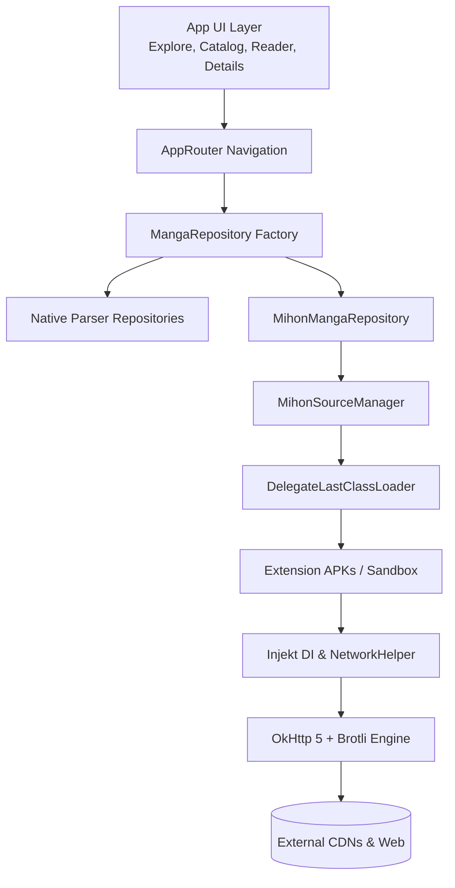

<div align="center">


# ⚡ ZERAVRIX Phone 2.0

**Next-Generation Manga & Manhwa Reader for Android**

[](https://zeravrix.pages.dev/)
[](https://github.com/zeravrix/ZERAVRIX-Phone)
[](https://github.com/zeravrix/ZERAVRIX-Phone)
[](LICENSE)
[](https://github.com/zeravrix/ZERAVRIX-Phone/releases)

<br/>

**ZERAVRIX Phone 2.0** combines the raw speed and efficiency of native source parsers with the boundless ecosystem of Tachiyomi / Mihon APK source extensions — all wrapped in a sleek Material Design 3 interface.

[Official Website](https://zeravrix.pages.dev/) • [Download Latest APK](https://github.com/zeravrix/ZERAVRIX-Phone/releases) • [Features](#-features) • [Architecture](#-architecture) • [Building](#-building-from-source)

</div>

---

## ✨ Features

### 🔌 Universal Extension Engine
- **Full Mihon & Tachiyomi Compatibility**: Seamlessly browse, install, trust, and run thousands of community source APKs directly.
- **Unified Catalog**: Search native and extension sources side-by-side with genuine APK icons, language tags, and instant download progress spinners.
- **1-Tap Explore Pinning**: Tap `+` on any installed source to pin it directly to your primary Explore tab.
- **Direct Repository Management**: Add and manage custom HTTPS extension repositories with live synchronized updates.

### 📖 Immersive Reader Experience
- **Adaptive Reading Modes**: Full support for Webtoon (continuous vertical scroll with zero gap), Left-to-Right, Right-to-Left, and Dual-Page landscape viewing.
- **Full Offline Downloads**: Fast, resilient multi-threaded background chapter downloads with pause, resume, and storage volume selection.
- **Brotli & OkHttp Acceleration**: Complete, unstripped Brotli and OkHttp network pipeline for lightning-fast image loading and CDN compatibility.
- **Smart Image Processing**: Dynamic split-image rendering, crop borders, and automatic color inversion for comfortable night reading.

### 🛡️ Privacy, Security & Control
- **Auto-Trust Architecture**: Streamlined extension sandbox automatically authenticates and activates user-installed extensions without blocking dialogues.
- **Content Ratings & NSFW Filter**: Complete parental and discretion controls across search, Explore, catalog, and extensions.
- **No Telemetry / No Trackers**: 100% private, client-side execution with local SQLite database storage and encrypted backup/restore.

---

## 🏗️ Architecture



---

## 📱 Tech Stack & Libraries

| Component | Implementation |
|---|---|
| **Architecture** | MVVM + Clean Architecture + Hilt DI |
| **Language** | 100% Kotlin + Modern Coroutines & StateFlow |
| **Networking** | OkHttp 5 + Brotli + Conscrypt + JSoup |
| **Image Loading** | Coil 3 + Subsampling Scale ImageView (SSIV) |
| **Local Database** | Android Jetpack Room (SQLite) + KSP |
| **Extension Sandbox** | Dalvik DelegateLastClassLoader + Injekt API |
| **Design System** | Google Material Design 3 + Dynamic Colors (Monet) |

---

## 🛠️ Building from Source

### Prerequisites
- **JDK**: OpenJDK 17 or 21 (or Android Studio JBR)
- **Android SDK**: Build Tools `35.0.0` or higher, Target SDK `34`
- **Gradle**: 9.0 (included via Gradle Wrapper)

### Build Steps

1. **Clone the repository:**
   ```bash
   git clone https://github.com/zeravrix/ZERAVRIX-Phone.git
   cd ZERAVRIX-Phone
   ```

2. **Assemble the Release APK:**
   ```bash
   ./gradlew assembleRelease
   ```
   *(On Windows: `.\gradlew.bat assembleRelease`)*

3. **Locate the Output Binary:**
   ```
   app/build/outputs/apk/release/app-release.apk
   ```

---

## 🤝 Contributing

We welcome pull requests and issues! Please ensure:
1. All changes adhere to Kotlin coding standards (`./gradlew lint`).
2. Unit and integration tests pass cleanly (`./gradlew test`).
3. Commit messages are clear and descriptive.

---

## 📄 License

ZERAVRIX Phone is open-source software licensed under the **GNU General Public License v3.0 (GPLv3)**.

---

<div align="center">
  <sub>Built with ❤️ by the ZERAVRIX Team • <a href="https://github.com/zeravrix/ZERAVRIX-Phone">github.com/zeravrix/ZERAVRIX-Phone</a></sub>
</div>
