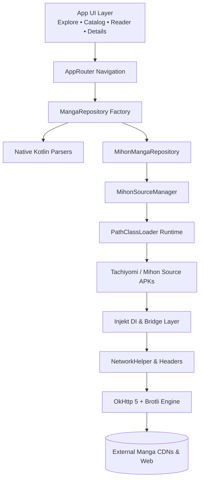

<div align="center">


# ⚡ ZERAVRIX Phone 2.0

**The Ultimate Next-Generation Manga, Manhwa & Comic Reader for Android**

<br/>

[](https://zeravrix.pages.dev/)
[-3DDC84.svg?style=for-the-badge&logo=android&logoColor=white)](https://github.com/zeravrix/ZERAVRIX-Phone/releases)
[](https://kotlinlang.org/)
[](LICENSE)
[](https://github.com/zeravrix/ZERAVRIX-Phone/releases/latest)

<br/>

🌐 Official Portal: [https://zeravrix.pages.dev/](https://zeravrix.pages.dev/)

ZERAVRIX Phone 2.0 combines the performance of native Kotlin parsers with the versatility of the Tachiyomi and Mihon APK extension ecosystem. Built on Material Design 3, powered by OkHttp 5 and Brotli, and featuring an auto-trust extension engine with Android Package Installer integration.

<br/>

[Download Latest Release APK](https://github.com/zeravrix/ZERAVRIX-Phone/releases/latest) • [Website](https://zeravrix.pages.dev/) • [Features](#key-features) • [Architecture](#architecture) • [Building](#building-from-source) • [Changelog](#changelog--release-notes)

</div>

---

## Key Features

### Universal Extension Engine & Package Installer
Full Mihon and Tachiyomi compatibility executing community extension APKs inside a secure sandbox or via the Android Package Installer. Pre-installed extensions on the device are automatically discovered, enabled, and pinned to the Explore screen by default. Includes interactive repository management with JSON repository URLs and live validation.

### Immersive Reader & Offline Engine
Adaptive viewing modes tailored for webtoons with zero-gap vertical scrolling, standard left-to-right, right-to-left, and dual-page landscape modes. Includes automatic border cropping, double-page split, and resilient background chapter downloads supporting external SD card and SAF directory targets. Hardware-accelerated rendering powered by Coil 3 and Subsampling Scale ImageView (SSIV).

### Accelerated Network Pipeline
Native Brotli decompression (`okhttp3.brotli`) active across all sources for faster chapter loading and reduced data usage. Features built-in Cloudflare solver browser, configurable HTTP headers, User-Agent rotation, and rate-limiting queue gates to prevent CDN IP bans.

### Privacy, Control & Design
Zero telemetry with no third-party analytics, tracking, or advertisements. All reading data and bookmarks remain local to the device. Content filter toggle for adult sources across catalog and search results. Material You dynamic color adaptation with true AMOLED Black theme support.

---

## Architecture



---

## Tech Stack & Technical Specifications

| Domain | Technology / Library | Description |
|---|---|---|
| Official Website | [zeravrix.pages.dev](https://zeravrix.pages.dev/) | Official portal and web home for ZERAVRIX ecosystem |
| Core Architecture | MVVM + Clean Architecture | Unidirectional data flow with state persistence |
| Language | Kotlin 2.0+ & Coroutines | 100% Kotlin codebase with Flow and StateFlow reactive state |
| Dependency Injection | Hilt / Dagger 2 | Scoped dependencies across Activities, ViewModels, and Workers |
| Local Database | Room (SQLite) + KSP | High-speed relational caching with type-safe migrations |
| Networking | OkHttp 5 + Brotli + Conscrypt | Modern HTTP/2 and HTTP/3 engine with Brotli decompression |
| Image Pipeline | Coil 3 + SSIV | Memory-optimized bitmap caching and deep-zoom tiling |
| Extension Sandbox | Dalvik PathClassLoader | Dynamic parent-first runtime isolation for Tachiyomi and Mihon APKs |
| UI Components | Google Material Design 3 | Material You dynamic color, Edge-to-Edge window insets |

---

## Getting Started

### Installation
1. Visit the [Releases Page](https://github.com/zeravrix/ZERAVRIX-Phone/releases/latest) or our [Official Website](https://zeravrix.pages.dev/).
2. Download `ZERAVRIX_Phone_2.0_release.apk`.
3. Open the downloaded file on your Android device and tap Install.
4. If prompted, allow "Install from Unknown Sources" in your device settings.

---

## Building from Source

### Prerequisites
- Android Studio: Ladybug / Meerkat or newer
- Java Development Kit (JDK): JDK 17 or JDK 21 (configured as `JAVA_HOME`)
- Android SDK: Build-Tools `35.0.0` or higher, SDK Platform `android-35`

### Build Steps

1. Clone the repository:
   ```bash
   git clone https://github.com/zeravrix/ZERAVRIX-Phone.git
   cd ZERAVRIX-Phone
   ```

2. Verify Gradle Wrapper:
   - Windows (PowerShell):
     ```powershell
     .\gradlew.bat --version
     ```
   - Linux / macOS:
     ```bash
     chmod +x gradlew
     ./gradlew --version
     ```

3. Assemble Debug Build:
   ```bash
   ./gradlew assembleDebug
   ```

4. Assemble Release Build:
   ```bash
   ./gradlew assembleRelease
   ```
   The optimized, minified APK will be generated at `app/build/outputs/apk/release/app-release.apk`.

---

## Changelog — Release v2.0.0

- Package Installer Integration: Prompts the standard Android system installer dialog on APK downloads for seamless user approval.
- Automatic Source Discovery & Pinning: Automatically scans all installed extension packages on the device and pins them in Explore by default.
- Full Mihon Extension Engine Integration: Browse, install, and execute community source APKs directly.
- Dynamic Download Progress: Circular animated progress indicator appears while downloading extensions, transitioning to a pin button on install.
- Unstripped Brotli Pipeline: PathClassLoader parent-first runtime resolution preventing R8/OkHttp classloader conflicts.
- Clean Chapter Titles: Eliminated redundant leading hash characters in chapter lists.
- Real ZK Logo Brand Identity: Preserved the authentic blue ZK logo on pure AMOLED black splash screens and across GitHub documentation.
- Theme & Locale Modernization: Removed deprecated Spider-Verse theme and legacy locale files for a cleaner, leaner binary.
- NSFW Filtration: Instant toggling of adult sources across catalog and search results.

---

## License

This project is licensed under the GNU General Public License v3.0 (GPL-3.0). See the [LICENSE](LICENSE) file for details.

---

<div align="center">
  <sub>Official Website: <a href="https://zeravrix.pages.dev/"><b>zeravrix.pages.dev</b></a></sub><br/>
  <sub>Developed with ❤️ for the global manga and manhwa reading community.</sub><br/>
  <b><a href="https://github.com/zeravrix/ZERAVRIX-Phone">github.com/zeravrix/ZERAVRIX-Phone</a></b>
</div>
